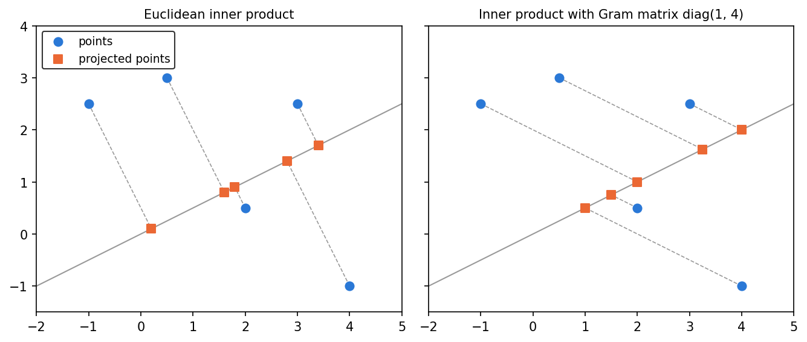
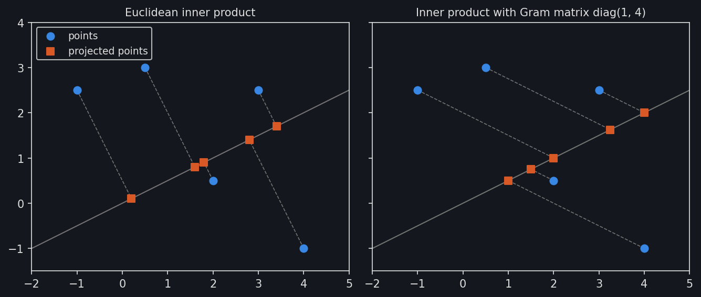

=========================
Projections and Distances
=========================

A point cloud can be projected onto a linear subspace, and the distance
between its points can be chosen. Both matter when a point cloud is compared
with a lower-dimensional view of itself, as the
:doc:`homological kernel <homological-kernel>` does, and both carry
gradients, so that a subspace or an inner product can be optimized.

Linear subspaces
================

A :py:class:`~stablebear.linear.LinearSubspace` is the span of a set of
vectors, given as the rows of an array. The vectors must be linearly
independent, but need not be orthogonal or of unit length.
:py:meth:`~stablebear.linear.LinearSubspace.project` replaces each point of a
point cloud by the point of the subspace closest to it::

   import numpy as np
   import stablebear as sb

   points = np.array([[-1.0, 2.5], [0.5, 3.0], [2.0, 0.5],
                      [3.0, 2.5], [4.0, -1.0]])
   line = sb.LinearSubspace([[2.0, 1.0]])

   projected = line.project(points)   # a PointCloud of shape (5, 2)

The projected points keep the coordinates of the original points: a point
cloud in the plane stays in the plane, with all its points on the line. A
projection never increases the distance between two points.

Inner products
==============

Which point of the subspace is closest depends on how lengths and angles are
measured. An :py:class:`~stablebear.linear.InnerProduct` is given by its Gram
matrix :math:`G`, a symmetric positive definite matrix, and measures the
vectors :math:`x` and :math:`y` against each other by :math:`x^T G y`. The
identity matrix gives the Euclidean inner product.

Calling an inner product on a point cloud gives an
:py:class:`~stablebear.linear.InnerProductSpace`, which holds the point cloud
together with its inner product. Projecting it uses that inner product, and
the result is again an ``InnerProductSpace``. With the vectors of the subspace
as the rows of :math:`V` and the points as the rows of :math:`X`, the
projected points are the rows of

.. math::

   X G V^T (V G V^T)^{-1} V.

The figure projects the same five points onto the same line twice: with the
Euclidean inner product, and with one in which lengths along the second
coordinate count four times as much.

::

   stretched = sb.InnerProduct([[1.0, 0.0], [0.0, 4.0]])

   projected = line.project(points)                    # Euclidean
   projected_stretched = line.project(stretched(points))

.. dropdown:: Show code
   :color: secondary

   .. literalinclude:: _static/gen_projection_figs.py
      :language: python
      :start-after: docs snippet start projection_inner_product --
      :end-before: docs snippet end projection_inner_product --

Circles are the points, squares their projections, and each dashed segment
joins a point to its projection. On the left the segments meet the line at a
right angle. On the right they are orthogonal to the line in the second inner
product: moving along the second coordinate is expensive there, so each point
reaches the line by moving mostly along the first. The projected points
differ, although the subspace is the same.

Distances
=========

Persistent homology and the homological kernel depend on a point cloud only
through the distances between its points. A plain point cloud has the
Euclidean distance. A :py:class:`~stablebear.linear.DistanceSpace` holds a
point cloud together with another :py:class:`~stablebear.linear.Distance`,
and :py:func:`~stablebear.persistence.homology.compute_persistent_homology`
and
:py:func:`~stablebear.persistence.homological_kernel.compute_homological_kernel`
take it in place of the point cloud.

There are two kinds of distance:

- The distance that an inner product induces,
  :math:`\sqrt{(x - y)^T G (x - y)}`. An ``InnerProductSpace`` is a
  ``DistanceSpace`` with this distance, so the result of a projection can be
  passed on directly.
- :py:class:`~stablebear.linear.LpDistance`, the distance of the :math:`L_p`
  norm for :math:`p \geq 1` or infinity. ``LpDistance(1)`` is the taxicab
  distance and ``LpDistance(float("inf"))`` the Chebyshev distance.

Calling a distance on a point cloud gives the ``DistanceSpace``::

   from stablebear import persistence

   taxicab = sb.LpDistance(1)
   barcodes = persistence.compute_persistent_homology(taxicab(points))

   # The distance of the inner product above.
   barcodes = persistence.compute_persistent_homology(stretched(points))

Operations that do not use a distance do not accept a ``DistanceSpace``, so
its distance is never silently ignored. A ``DistanceSpace`` that is not an
``InnerProductSpace`` cannot be projected, because an orthogonal projection
needs an inner product.

The kernel of a point cloud and its projection
==============================================

The homological kernel compares two sets of distances on the same points, of
which the first must be at least as large as the second. A point cloud and
its projection satisfy this when both use the inner product of the
projection::

   space = stretched(points)

   kernel = persistence.compute_homological_kernel(space, line.project(space))

Both arguments must be ``DistanceSpace`` objects with equal distances, or
both plain point clouds.

Batches
=======

Every operation on this page also takes a batch of point clouds as a
:py:class:`~stablebear.point_cloud.PointCloudTensor`, alone or in a
``DistanceSpace``, and treats each point cloud separately. The point clouds
of a batch may have different numbers of points::

   clouds = sb.PointCloudTensor([points, points[:3]])

   projected = line.project(clouds)                       # a PointCloudTensor
   barcodes = persistence.compute_persistent_homology(taxicab(clouds))

Optimizing a subspace
=====================

The points, the vectors of a subspace, and the Gram matrix of an inner
product can each be a PyTorch, JAX, or TensorFlow array. The results then
carry gradients with respect to each of them that is one. The example looks
for the plane that keeps the distances of a point cloud in three dimensions
best: it minimizes the area under the stable rank of the kernel of the point
cloud and its projection, which is the total length of the bars of the
kernel.

::

   import torch

   rng = np.random.default_rng(0)
   cloud = rng.normal(size=(30, 3)) * np.array([3.0, 1.0, 0.2])
   space = sb.InnerProduct(np.eye(3))(cloud)

   vectors = torch.tensor([[0.0, 0.0, 1.0],
                           [0.0, 1.0, 0.0]], dtype=torch.float64,
                          requires_grad=True)
   optimizer = torch.optim.Adam([vectors], lr=0.05)

   for step in range(100):
       optimizer.zero_grad()
       projected = sb.LinearSubspace(vectors).project(space)
       kernel = persistence.compute_homological_kernel(space, projected)
       stable_rank = persistence.barcode_to_stable_rank(kernel)
       loss = sb.lp_norm(stable_rank, p=1).sum()
       loss.backward()
       optimizer.step()

The point cloud varies most along its first coordinate and least along its
third. The plane starts as the one spanned by the second and third
coordinates, and the loss falls from about 18.8 to about 1.3 as the plane
turns toward the first two coordinates.

Some restrictions apply to gradients:

- Projection works while JAX or ``tf.function`` traces its inputs. Persistent
  homology does not, because the number of bars depends on the points, and
  neither does the homological kernel with an ``LpDistance`` other than
  ``LpDistance(2)``.
- Persistent homology and the homological kernel with gradients take a single
  point cloud. Projection also takes a batch.
- That a Gram matrix is symmetric positive definite and that the vectors of a
  subspace are linearly independent is checked only for values that are not
  being traced.
