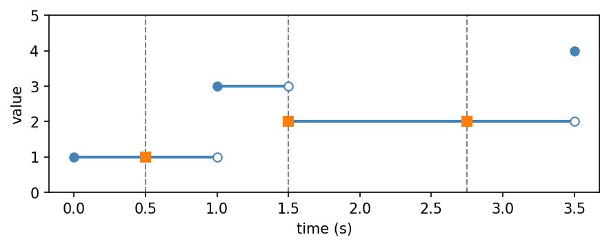
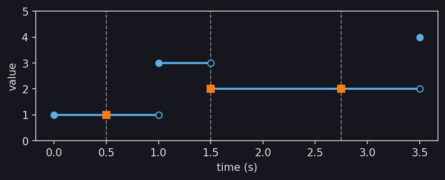

Time series
===========

A time series records observations at known times. Each observation can be a
number, an array, or an element such as a point cloud. A
:py:class:`~stablebear.timeseries.TimeSeries` is built from the observations
and one timestamp per observation; plain timestamp arrays are in seconds, and
:py:class:`~stablebear.timeseries.Times` gives them another unit::

   from stablebear.timeseries import TimeSeries

   series = TimeSeries([1.0, 3.0, 2.0, 4.0], times=[0.0, 1.0, 1.5, 3.5])

Evaluation
----------

For observations :math:`x_0, \dots, x_{n-1}` at timestamps
:math:`t_0 < \dots < t_{n-1}`,
:py:meth:`~stablebear.timeseries.TimeSeries.evaluate` computes

.. math::

   x(t) = x_i \quad \text{for } t_i \le t < t_{i+1},
   \qquad x(t_{n-1}) = x_{n-1},

on the domain :math:`[t_0, t_{n-1}]`::

   series(0.5)   # 1.0
   series(1.5)   # 2.0
   series(2.75)  # 2.0
   series(4.0)   # ValueError: Time 4 is outside the domain [0, 3.5]

The figure shows the series as a step function. The circles are the
observations, and the squares are the three queries above.

.. dropdown:: Show plotting code
   :color: secondary

   .. literalinclude:: _static/gen_timeseries_snap_fig.py
      :pyobject: plot_timeseries_evaluation
      :language: python

A query at a timestamp gets the observation recorded there, as at
``t = 1.5``.

Queries computed in floating point
----------------------------------

Query times are often computed, for example as ``0.3 - 0.1``, and rounding
can put them just below the timestamp they mean. Evaluation snaps such
queries forward to that timestamp, so on a series with a timestamp at 0.2,
the query ``0.3 - 0.1`` returns the observation recorded there rather than
the one before it. Only queries within a rounding error of a timestamp
snap; the defaults fit most data. The ``snap_tolerance`` and ``snap_eps``
arguments of :py:class:`~stablebear.timeseries.TimeSeries` set the limits,
and the page below explains them in detail.

.. toctree::
   :maxdepth: 1

   timeseries_snapping
