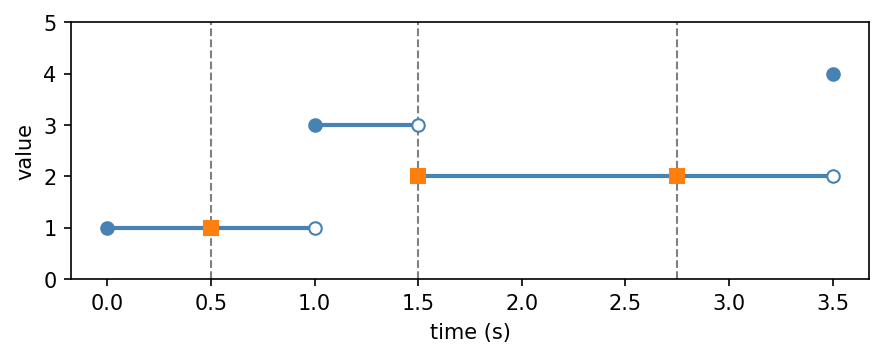
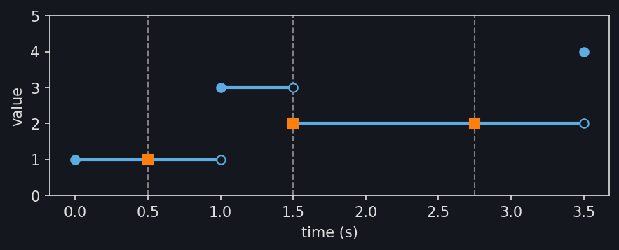

Time series
===========

A time series records observations at known times. Each observation can be a
number, an array, or an element such as a point cloud. A
:py:class:`~stablebear.timeseries.TimeSeries` is built from the observations
and one timestamp per observation. The timestamps are durations from the
time 0 of the time series, here a
:py:class:`~stablebear.timeseries.TimeDeltaTensor` of seconds::

   from stablebear.timeseries import TimeDelta, TimeDeltaTensor, TimeSeries

   series = TimeSeries([1.0, 3.0, 2.0, 4.0],
                       times=TimeDeltaTensor([0.0, 1.0, 1.5, 3.5], "s"))

Durations can also be given in other forms, such as a ``timedelta64``
array, and timestamps can be dates and times (see :doc:`timeseries_dates`).

This page covers evaluation and units, which every other operation on a
time series builds on. The pages listed at the end cover channels, delay
embeddings, and windows.

Evaluation
----------

For observations :math:`x_0, \dots, x_{n-1}` at timestamps
:math:`t_0 < \dots < t_{n-1}`,
:py:meth:`~stablebear.timeseries.TimeSeries.evaluate` computes

.. math::

   x(t) = x_i \quad \text{for } t_i \le t < t_{i+1},
   \qquad x(t_{n-1}) = x_{n-1},

on the domain :math:`[t_0, t_{n-1}]`. The figure shows ``series`` from the
example above as a step function on its domain :math:`[0, 3.5]`. The filled
circles are the observations, and an open circle marks the right end of a
step, which belongs to the next step. The squares are queries at 0.5, 1.5,
and 2.75 s.

.. dropdown:: Show plotting code
   :color: secondary

   .. literalinclude:: _static/gen_timeseries_snap_fig.py
      :pyobject: plot_timeseries_evaluation
      :language: python

Each query is a duration, a :py:class:`~stablebear.timeseries.TimeDelta`,
and returns the value of the step it falls on. A unit passed as the second
argument reads numbers as counts of it, so ``series(0.5, "s")`` is
``series(TimeDelta(0.5, "s"))``. A query past the last timestamp is outside
the domain and raises an error::

   series(TimeDelta(0.5, "s"))  # 1.0
   series(1.5, "s")             # 2.0
   series(2750.0, "ms")         # 2.0
   series(4.0, "s")             # ValueError: Time 4 is outside the domain [0, 3.5]

A query at a timestamp gets the observation recorded there, as at 1.5 s.
A number without a unit raises a ``TypeError``, since it does not say which
unit it counts.

Units
-----

A time series stores its timestamps as numbers of one unit, its
:py:attr:`~stablebear.timeseries.TimeSeries.unit`, from attoseconds
(``"as"``) to days (``"d"``). Durations in other units are converted into
it, as the query in milliseconds above is.
:py:meth:`TimeSeries.to <stablebear.timeseries.TimeSeries.to>` converts the
stored timestamps to another unit; :doc:`timeseries_units` explains how the
unit affects precision and lists the units::

   series.to("ms").times  # TimeDeltaTensor([0.0, 1000.0, 1500.0, 3500.0], 'ms')

Time series without a unit
--------------------------

When the times are not physical, such as sample indices or the values of a
parameter, plain numbers give a time series without a unit, whose
:py:attr:`~stablebear.timeseries.TimeSeries.unit` is ``None``. It is
queried at plain numbers, and window sizes and delays for it are plain
numbers too::

   steps = TimeSeries([1.0, 3.0, 2.0, 4.0], times=[0.0, 1.0, 1.5, 3.5])
   steps(1.5)  # 2.0

A duration on a time series without a unit raises a ``TypeError``, as a
number without a unit does on a time series with one. Calling
:py:meth:`~stablebear.timeseries.TimeSeries.to` gives it a unit: its
numbers become counts of that unit, so ``steps.to("s")`` equals
``series``.

Working with time series
------------------------

The following pages build on evaluation. Channels combine signals with
different timestamps and units into one time series. A delay embedding turns a
signal into points that trace its dynamics, and windows cut a time series into
pieces that can be compared with each other.
Snapping covers query times such as ``0.3 - 0.1`` that land a rounding error
below the timestamp they mean. Dates and times covers series recorded with
dates, queried at dates, and cut into windows of durations, and Plotting
shows how to draw time series and their windows.
The notebook :doc:`tutorial_notebooks/timeseries_tides` combines delay
embeddings and windows to follow the tides in a tide gauge record with
stable ranks.

.. toctree::
   :maxdepth: 1

   timeseries_units
   timeseries_channels
   timeseries_embedding
   timeseries_windows
   timeseries_snapping
   timeseries_dates
   timeseries_plotting
