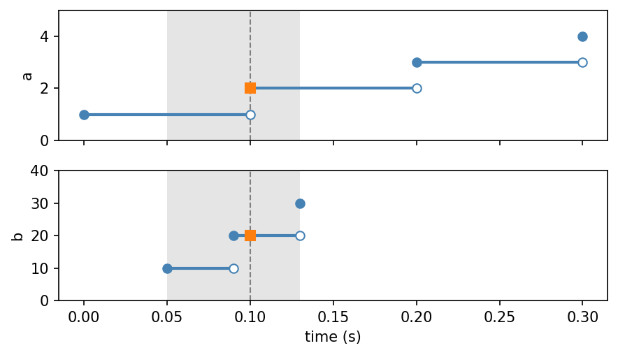
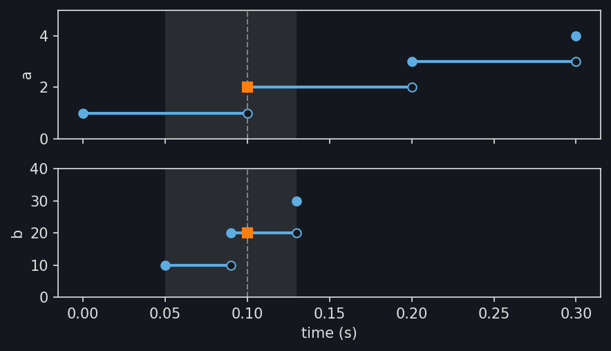
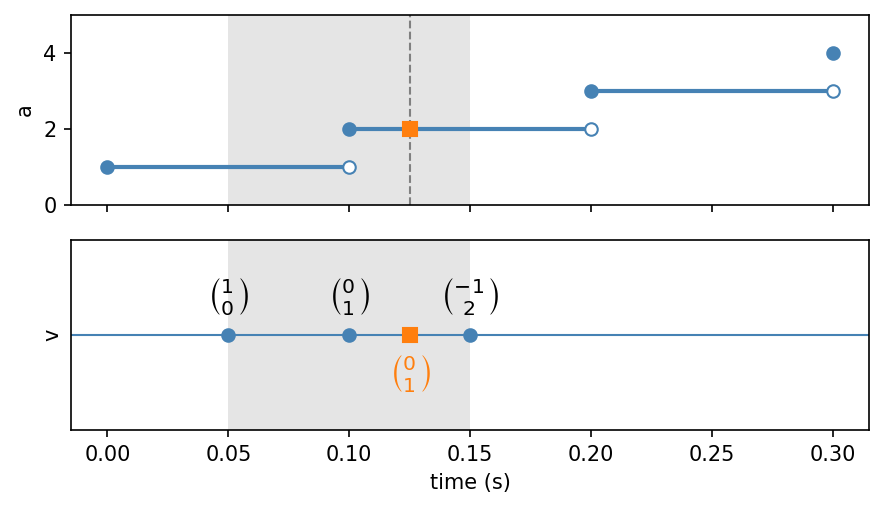
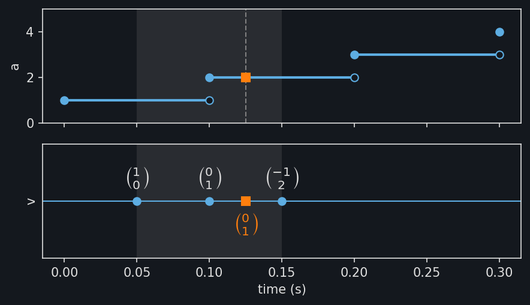

Channels
========

Signals recorded by different instruments rarely share timestamps or units.
:py:meth:`TimeSeries.from_channels
<stablebear.timeseries.TimeSeries.from_channels>` keeps each signal as a
channel with its own timestamps and snapping (see
:doc:`timeseries_snapping`), converted into the unit of the time series by
an exact factor (see :doc:`timeseries_units`).

Here channel ``a`` is sampled every 0.1 s from 0 s, and channel ``b`` every
40 ms from 50 ms::

   from stablebear.timeseries import TimeDeltaTensor, TimeSeries

   a = TimeSeries([1.0, 2.0, 3.0, 4.0],
                  times=TimeDeltaTensor([0.0, 0.1, 0.2, 0.3], "s"))
   b = TimeSeries([10.0, 20.0, 30.0],
                  times=TimeDeltaTensor([50.0, 90.0, 130.0], "ms"))
   series = TimeSeries.from_channels([a, b], unit="s")

A time series can be evaluated only where all of its channels can, here from
0.05 s, when ``b`` starts, to 0.13 s, when ``b`` ends. The figure shows both
channels with this domain shaded. The squares are a query at 0.1 s.

.. dropdown:: Show plotting code
   :color: secondary

   .. literalinclude:: _static/gen_timeseries_snap_fig.py
      :pyobject: plot_timeseries_channels
      :language: python

The query returns one value from each channel. A query outside the shaded
domain raises an error, even where ``a`` alone has observations::

   series(0.1, "s")  # OK
   series(0.0, "s")  # ValueError: Time 0 is outside the domain [0.05, 0.13]

Evaluating several channels gives a
:py:class:`~stablebear.nested_tensor.NestedTensor` with one entry per
channel, in channel order, since channels can hold observations of different
shapes. Index it by channel to get each channel's value::

   values = series(0.1, "s")
   float(values[0])  # 2.0, from a
   float(values[1])  # 20.0, from b

With several query times, each entry holds that channel's values at all of
them::

   values = series([0.06, 0.1], "s")
   values[0]  # FloatTensor [1.0, 2.0], from a
   values[1]  # FloatTensor [10.0, 20.0], from b

Indexing with ``series[i]`` selects channel ``i`` as a time series of its
own.

Channels with different shapes
------------------------------

Channels can hold observations of different shapes. Here channel ``v``
holds vectors of length 2 at 0.05, 0.1, and 0.15 s, next to channel ``a``
from above::

   v = TimeSeries([[1.0, 0.0], [0.0, 1.0], [-1.0, 2.0]],
                  times=TimeDeltaTensor([0.05, 0.1, 0.15], "s"))
   mixed = TimeSeries.from_channels([a, v])

The figure shows ``a`` as a step function and ``v`` with each vector above
its timestamp. The shared domain is shaded, and the squares are a query at
0.125 s; the vector below the line is the one the query returns.

.. dropdown:: Show plotting code
   :color: secondary

   .. literalinclude:: _static/gen_timeseries_snap_fig.py
      :pyobject: plot_timeseries_vector_channel
      :language: python

Each entry of the result has the shape of its channel's observations::

   values = mixed(0.125, "s")
   float(values[0])  # 2.0, from a
   values[1]         # FloatTensor [0.0, 1.0], from v

With several query times, the entry for ``v`` holds one vector per query
time::

   values = mixed([0.06, 0.125], "s")
   values[1]  # FloatTensor [[1.0, 0.0], [0.0, 1.0]], shape (2, 2)

Combining channels into one
---------------------------

:py:func:`sb.stack <stablebear.tensor_create.stack>` combines the channels of a series
into one channel, as it stacks tensors. Its observation at each time
stacks the observations of the channels in effect then, along a new axis.
The times are the start of the domain and every time in the domain at which
a channel has an observation. For ``a`` and ``b`` from above::

   import stablebear as sb

   stacked = sb.stack(series)
   stacked.times.count  # [0.05, 0.09, 0.1, 0.13]
   stacked.values       # FloatTensor [[1.0, 10.0], [1.0, 20.0],
                        #              [2.0, 20.0], [2.0, 30.0]]

Observations outside the domain are dropped, such as those of ``a`` at 0,
0.2, and 0.3 s. One that stays in effect over several of the times, such as
``b``'s 20.0 at 0.09 and 0.1 s, is repeated at each. To combine separate
series, make them the channels of one with ``from_channels`` first; a list
of series raises ``TypeError``.

:py:func:`sb.concatenate <stablebear.tensor_create.concatenate>` joins observations
along an existing axis instead, so channels of vectors of lengths 2 and 3
give vectors of length 5. Channels of numbers have no axis to join along;
stack them instead.

Functions that take a series of one channel, such as
:py:func:`~stablebear.timeseries.to_point_clouds`, take the combined
series.

Tensors of series
-----------------

Channels are signals observed together, which a query evaluates at the
same time. Separate series, such as recordings from different stations or
runs of a simulation, go into a tensor instead, with one series per
element. :py:func:`sb.tensor <stablebear.tensor_create.tensor>` makes one
from a list, or nested lists, of series::

   tensor = sb.tensor([a, b])
   tensor.shape  # (2,)
   tensor.dtype  # ts(float64)
   tensor[1]     # the series b, with its own times in ms

The series of a tensor keep their own times, units, and channels, but
share the dtype of their observations. The dtype of a tensor of series of
``float64`` observations is ``sb.ts(sb.float64)``, and
:py:func:`sb.zeros <stablebear.tensor_create.zeros>` with that dtype makes
a tensor of empty series, whose elements are then assigned.
:py:meth:`~stablebear.timeseries.series.TimeSeriesTensor.evaluate` and
:py:func:`~stablebear.timeseries.to_point_clouds` take a tensor of series
as they take the windows of a series (see :doc:`timeseries_windows`).

The tensor ``sb.tensor([a, b])`` holds two series, while
``sb.stack(TimeSeries.from_channels([a, b]))`` is one series whose
observations are pairs of values of ``a`` and ``b``, taken at the times
where both are defined.
