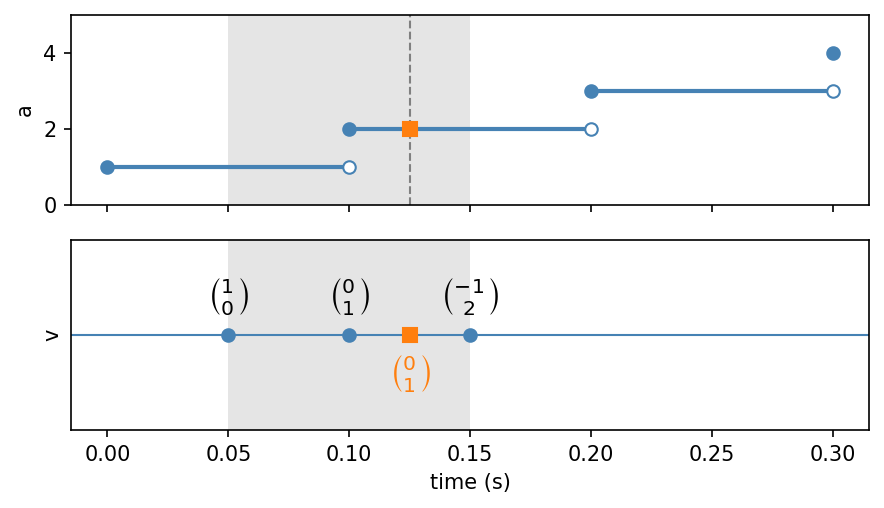
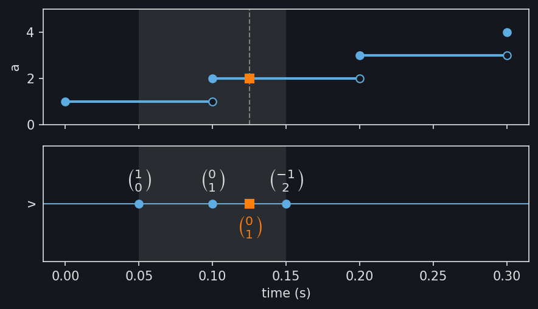

Channels
========

Signals recorded by different instruments rarely share timestamps or units.
:py:meth:`TimeSeries.from_channels
<stablebear.timeseries.TimeSeries.from_channels>` keeps each signal as a
channel with its own timestamps, unit, and snapping (see
:doc:`timeseries_snapping`). Every query is converted from the time series' unit
into each channel's unit (see :doc:`timeseries_units`).

Here channel ``a`` is sampled every 0.1 s from 0 s, and channel ``b`` every
40 ms from 50 ms::

   from stablebear.timeseries import TimeSeries, Times

   a = TimeSeries([1.0, 2.0, 3.0, 4.0], times=[0.0, 0.1, 0.2, 0.3])
   b = TimeSeries([10.0, 20.0, 30.0],
                  times=Times([50.0, 90.0, 130.0], unit="ms"))
   series = TimeSeries.from_channels([a, b], unit="s")

A time series can be evaluated only where all of its channels can, here from
0.05 s, when ``b`` starts, to 0.13 s, when ``b`` ends. The figure shows both
channels with this domain shaded. The squares are a query at ``t = 0.1``.

.. image:: _static/timeseries_channels_light.png
   :width: 80%
   :class: only-light
   :alt: Two channels as step functions, with their shared domain shaded

.. image:: _static/timeseries_channels_dark.png
   :width: 80%
   :class: only-dark
   :alt: Two channels as step functions, with their shared domain shaded

.. dropdown:: Show plotting code
   :color: secondary

   .. literalinclude:: _static/gen_timeseries_snap_fig.py
      :pyobject: plot_timeseries_channels
      :language: python

The query returns one value from each channel. A query outside the shaded
domain raises an error, even where ``a`` alone has observations::

   series(0.1)  # OK
   series(0.0)  # ValueError: Time 0 is outside the domain [0.05, 0.13]

Evaluating several channels gives a
:py:class:`~stablebear.nested_tensor.NestedTensor` with one entry per
channel, in channel order, since channels can hold observations of different
shapes. Index it by channel to get each channel's value::

   values = series(0.1)
   float(values[0])  # 2.0, from a
   float(values[1])  # 20.0, from b

With several query times, each entry holds that channel's values at all of
them::

   values = series([0.06, 0.1])
   values[0]  # FloatTensor [1.0, 2.0], from a
   values[1]  # FloatTensor [10.0, 20.0], from b

``series[i]`` selects channel ``i`` as a time series of its own.

Channels with different shapes
------------------------------

Channels can hold observations of different shapes. Here channel ``v``
holds vectors of length 2 at 0.05, 0.1, and 0.15 s, next to channel ``a``
from above::

   v = TimeSeries([[1.0, 0.0], [0.0, 1.0], [-1.0, 2.0]],
                  times=[0.05, 0.1, 0.15])
   mixed = TimeSeries.from_channels([a, v])

The figure shows ``a`` as a step function and ``v`` with each vector above
its timestamp. The shared domain is shaded, and the squares are a query at
``t = 0.125``; the vector below the line is the one the query returns.

.. dropdown:: Show plotting code
   :color: secondary

   .. literalinclude:: _static/gen_timeseries_snap_fig.py
      :pyobject: plot_timeseries_vector_channel
      :language: python

Each entry of the result has the shape of its channel's observations::

   values = mixed(0.125)
   float(values[0])  # 2.0, from a
   values[1]         # FloatTensor [0.0, 1.0], from v

With several query times, the entry for ``v`` holds one vector per query
time::

   values = mixed([0.06, 0.125])
   values[1]  # FloatTensor [[1.0, 0.0], [0.0, 1.0]], shape (2, 2)
