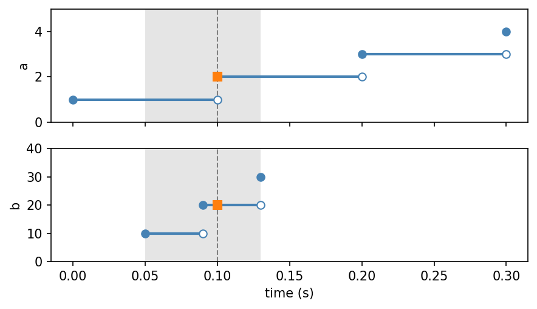
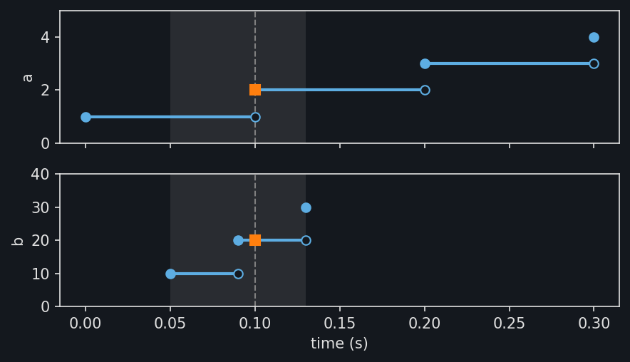

Channels
========

Signals recorded by different instruments rarely share timestamps or units.
:py:meth:`TimeSeries.from_channels
<stablebear.timeseries.TimeSeries.from_channels>` keeps each signal as a
channel with its own timestamps, unit, and snapping (see
:doc:`timeseries_snapping`). Every query is converted from the series' unit
into each channel's unit (see :doc:`timeseries_units`).

Here channel ``a`` is sampled every 0.1 s from 0 s, and channel ``b`` every
40 ms from 50 ms::

   from stablebear.timeseries import TimeSeries, Times

   a = TimeSeries([1.0, 2.0, 3.0, 4.0], times=[0.0, 0.1, 0.2, 0.3])
   b = TimeSeries([10.0, 20.0, 30.0],
                  times=Times([50.0, 90.0, 130.0], unit="ms"))
   series = TimeSeries.from_channels([a, b], unit="s")

A series can be evaluated only where all of its channels can, here from
0.05 s, when ``b`` starts, to 0.13 s, when ``b`` ends. The figure shows both
channels with this domain shaded. The squares are a query at ``t = 0.1``.

.. dropdown:: Show plotting code
   :color: secondary

   .. literalinclude:: _static/gen_timeseries_snap_fig.py
      :pyobject: plot_timeseries_channels
      :language: python

The query returns one value from each channel. A query outside the shaded
domain raises an error, even where ``a`` alone has observations::

   series(0.1)  # NestedTensor: 2.0 from a, 20.0 from b
   series(0.0)  # ValueError: Time 0 is outside the domain [0.05, 0.13]

Evaluating several channels gives a ``NestedTensor`` with one entry per
channel, in channel order, since channels can hold observations of different
shapes. ``series[i]`` selects channel ``i`` as a series of its own.

Embedding and windowing channels
--------------------------------

A :doc:`delay embedding <timeseries_embedding>` and
:doc:`windows <timeseries_windows>` act on each channel separately. Here
channel ``a`` is sampled every 0.1 s, and channel ``b`` every 40 ms from
250 ms. Both have period 2 s, and a delay of a quarter period traces a closed
loop in each::

   import numpy as np
   from stablebear.persistence import compute_persistent_homology
   from stablebear.timeseries import TimeDelayEmbedding, Window

   ta = np.arange(0.0, 6.0, 0.1)
   a = TimeSeries(np.sin(np.pi * ta), times=ta)
   tb = np.arange(250.0, 6000.0, 40.0)
   b = TimeSeries(np.sin(np.pi * tb / 1000.0) ** 3,
                  times=Times(tb, unit="ms"))
   series = TimeSeries.from_channels([a, b], unit="s")

   embedded = TimeDelayEmbedding(dimension=2, delay=0.5)(series)
   embedded.shape  # ((2,), (2,))

The embedding has the full history only from 0.75 s, half a second after
the series starts, so its domain is :math:`[0.75, 5.9]`. Windows of 2 s,
evaluated on a grid of 40 times, give one point cloud per window and
channel::

   windows = Window(size=2.0, step=1.0)(embedded)
   points = windows(np.arange(40) * 2.0 / 40)
   for channel in (0, 1):
       barcodes = compute_persistent_homology(points[channel], max_dim=1)

Each window holds one full period, so every window of a channel gives the
same longest H1 bar. Channel ``a`` traces a circle, with a bar of length
about 1.47. Cubing the sine in channel ``b`` pinches its loop into a curve
with four cusps that encloses a smaller hole, with a bar of about 0.80.
