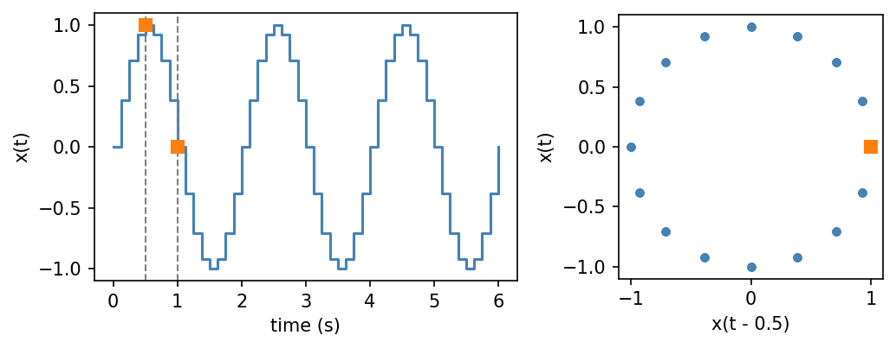
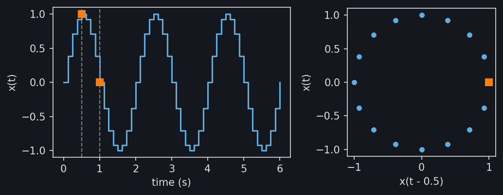

Delay embeddings
================

A delay embedding turns a signal into points built from its values at
several delayed times. Let :math:`x \colon \mathbb{R} \to \mathbb{R}` be a series of
numbers, evaluated as in :doc:`timeseries`. With
:py:class:`~stablebear.timeseries.TimeDelayEmbedding` of dimension :math:`m`
and delay :math:`\delta > 0`, the value of :math:`x` at time :math:`t` becomes

.. math::

   \begin{bmatrix} x\bigl(t - (m-1)\delta\bigr) & \dots & x\bigl(t - \delta\bigr) & x\bigl(t\bigr) \end{bmatrix} \in \mathbb{R}^m.

For a sine with period 2 s, a delay of a quarter period traces a circle::

   import numpy as np
   from stablebear.timeseries import TimeDelayEmbedding, TimeSeries

   t = np.linspace(0.0, 6.0, 49)
   signal = TimeSeries(np.sin(np.pi * t), times=t)
   embedded = TimeDelayEmbedding(dimension=2, delay=0.5)(signal)

   embedded.shape  # (2,)
   embedded(1.0)   # [1.0, 0.0], the values at 0.5 s and 1 s

The figure shows ``signal`` on the left and the embedded points on the
right, one per observation. The squares mark the values at 0.5 s and 1 s
and the point they form at ``t = 1``.

.. dropdown:: Show plotting code
   :color: secondary

   .. literalinclude:: _static/gen_timeseries_snap_fig.py
      :pyobject: plot_timeseries_embedding
      :language: python

The embedding has the full history only from :math:`(m-1)\delta` after the
series starts, so its domain is :math:`[0.5, 6]`::

   embedded(0.4)   # ValueError: Time 0.4 is outside the domain [0.5, 6]

More generally, the observations can be arrays or elements such as point
clouds. For a series :math:`x \colon \mathbb{R} \to X` with observations in
a space :math:`X`, the embedding takes values in :math:`X^m`.

The embedding shares the observations of ``signal`` instead of copying
them, and the delay is read in the unit of the series. To study the shape
of the embedded points over time, cut the embedding into
:doc:`windows <timeseries_windows>`. On a series with several
:doc:`channels <timeseries_channels>`, each channel is embedded separately.

Looking forward
---------------

With ``direction="forward"``, the components look ahead of :math:`t`
instead:

.. math::

   \begin{bmatrix} x\bigl(t\bigr) & x\bigl(t + \delta\bigr) & \dots & x\bigl(t + (m-1)\delta\bigr) \end{bmatrix} \in X^m.

The components keep the same order, so the forward point at :math:`t` is the
backward point at :math:`t + (m-1)\delta`. The domain now ends :math:`(m-1)\delta`
before the series does::

   forward = TimeDelayEmbedding(dimension=2, delay=0.5, direction="forward")(signal)

   forward(0.5)  # [1.0, 0.0], the values at 0.5 s and 1 s
   forward(5.6)  # ValueError: Time 5.6 is outside the domain [0, 5.5]

Takens's theorem
----------------

Delay embeddings are justified by Takens's theorem
:footcite:`Takens1981`. Suppose the signal is a smooth measurement of a
dynamical system whose states lie on a compact manifold of dimension
:math:`n`. For a generic system and measurement, the delay embedding with
dimension :math:`m \ge 2n + 1` is an embedding of the state space: distinct
states give distinct points, and the embedded points have the same topology
as the states. The persistence of embedded sample points can therefore
estimate the topology of the states, not only of the signal. The sine above
comes from a periodic system, whose states form a circle (:math:`n = 1`).
Its embedding is already a circle at :math:`m = 2`: the bound
:math:`2n + 1` is sufficient, not necessary.

References
----------

.. footbibliography::
