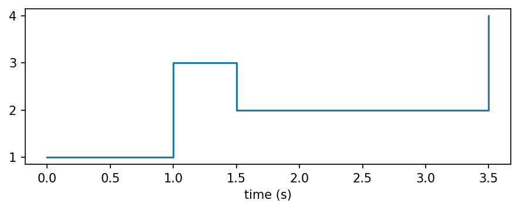
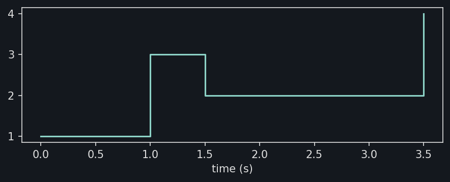
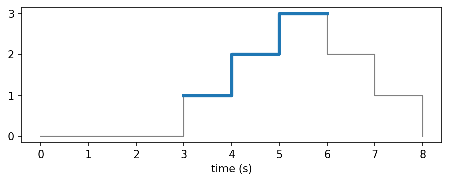
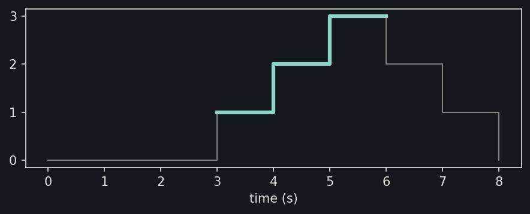
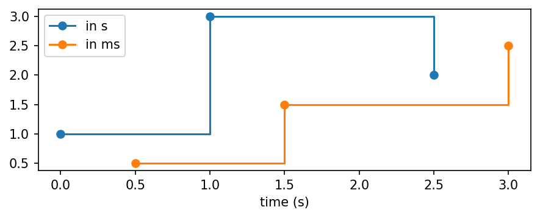
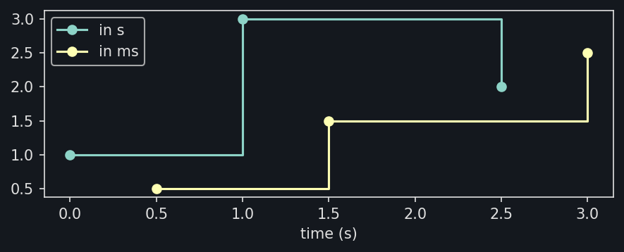

Plotting
========

:py:func:`~stablebear.plotting.plot_timeseries` draws a time series as the
step function it evaluates to, with matplotlib. Each value holds from its
observation until the next one, and the last until the end of the domain.
The time axis is labeled with the unit of the time series. With
``markers=True``, each observation is marked with a dot, which also shows
the last value, held only at the end of the domain, here 4 at 3.5 s::

   import matplotlib.pyplot as plt
   from stablebear.plotting import plot_timeseries
   from stablebear.timeseries import TimeSeries

   series = TimeSeries([1.0, 3.0, 2.0, 4.0], times=[0.0, 1.0, 1.5, 3.5])

   fig, ax = plt.subplots()
   plot_timeseries(series, ax=ax, markers=True)

.. dropdown:: Show plotting code
   :color: secondary

   .. literalinclude:: _static/gen_timeseries_plotting_fig.py
      :pyobject: plot_timeseries_steps
      :language: python

Windows in place
----------------

A window is drawn where it was cut from its time series, at its
:py:attr:`~stablebear.timeseries.TimeSeries.origin` plus its own times, so
that it lines up with the series on the same axes. Here the window of 3 s
starting at 3 s is drawn over the series it was cut from::

   from stablebear.timeseries import Window

   series = TimeSeries([0.0, 0.0, 0.0, 1.0, 2.0, 3.0, 2.0, 1.0, 0.0],
                       times=[0.0, 1.0, 2.0, 3.0, 4.0, 5.0, 6.0, 7.0, 8.0])
   window = Window(size=3.0, step=3.0, anchor="start")(series)[1]

   fig, ax = plt.subplots()
   plot_timeseries(series, ax=ax, color="gray", linewidth=1)
   plot_timeseries(window, ax=ax, linewidth=3)

.. dropdown:: Show plotting code
   :color: secondary

   .. literalinclude:: _static/gen_timeseries_plotting_fig.py
      :pyobject: plot_timeseries_window_in_place
      :language: python

Time units
----------

The first time series drawn on an axes sets the unit of its time axis, or
``unit=`` chooses it. Every later time series is converted into that unit
exactly, so time series recorded in different units line up. Here one is in
seconds and the other in milliseconds::

   import matplotlib.pyplot as plt
   from stablebear.plotting import plot_timeseries
   from stablebear.timeseries import Times, TimeSeries

   seconds = TimeSeries([1.0, 3.0, 2.0], times=[0.0, 1.0, 2.5])
   milliseconds = TimeSeries([0.5, 1.5, 2.5],
                             times=Times([500.0, 1500.0, 3000.0], unit="ms"))

   fig, ax = plt.subplots()
   plot_timeseries(seconds, ax=ax, markers=True, label="in s")
   plot_timeseries(milliseconds, ax=ax, markers=True, label="in ms")

The time axis is in seconds, set by ``seconds``, and the observations of
``milliseconds`` at 500, 1500, and 3000 ms are drawn at 0.5, 1.5, and
3 s.

.. dropdown:: Show plotting code
   :color: secondary

   .. literalinclude:: _static/gen_timeseries_plotting_fig.py
      :pyobject: plot_timeseries_units
      :language: python
