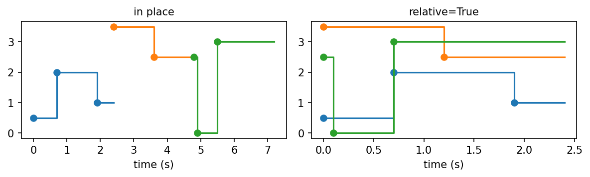
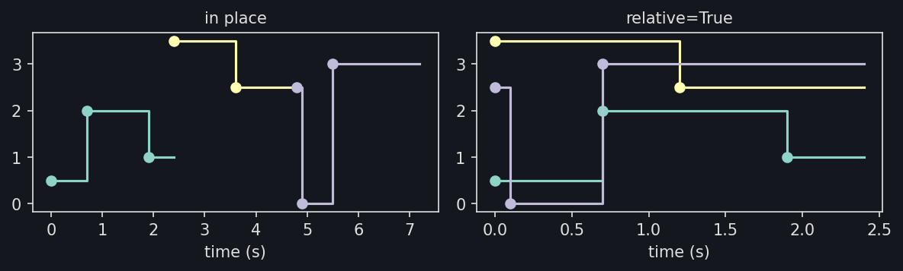
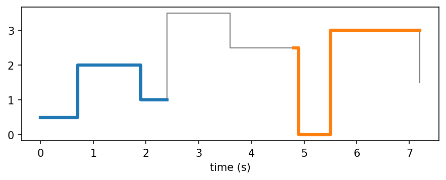
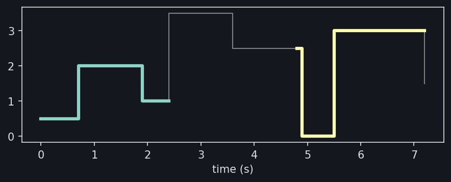
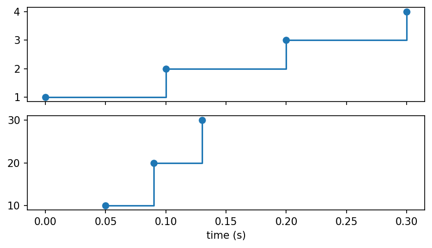
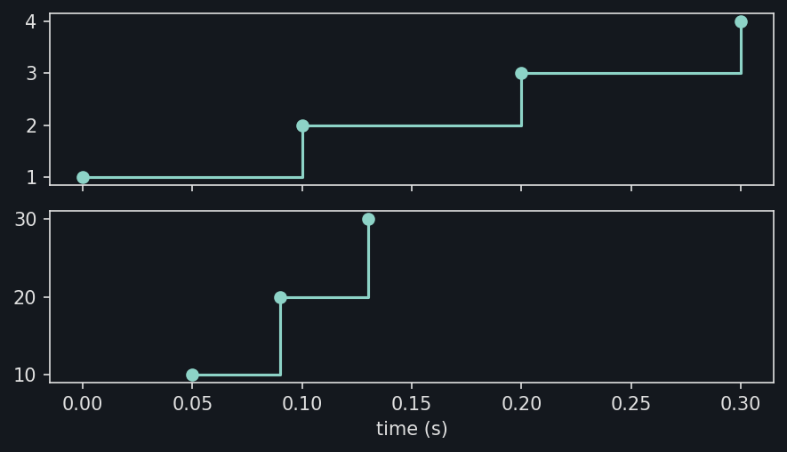
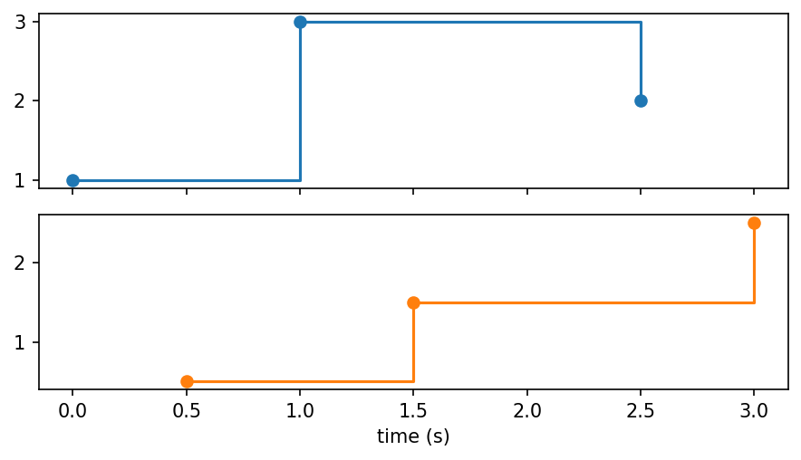
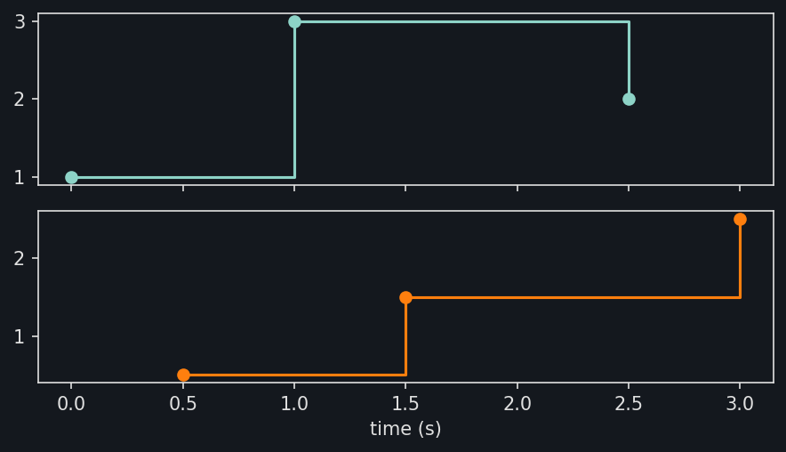
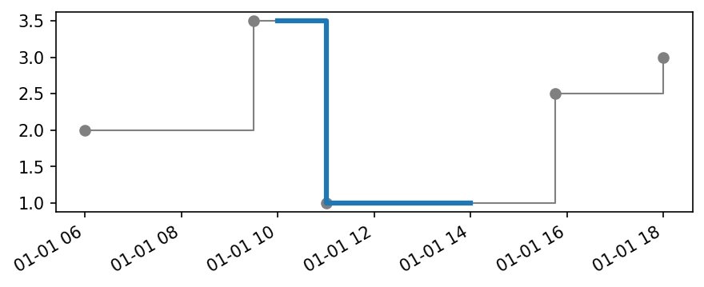
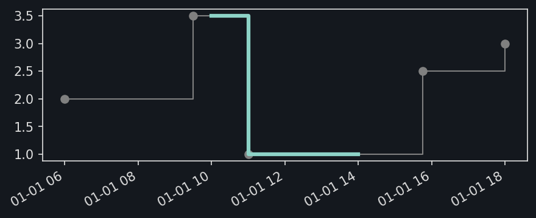

Plotting
========

:py:func:`~stablebear.plotting.plot_timeseries` draws a time series as the
step function it evaluates to, with matplotlib. Each value holds from its
observation until the next one, and the last until the end of the domain.
Only time series of numbers can be drawn; for other elements, such as point
clouds or barcodes, evaluate the time series and plot the elements
themselves. The time axis is labeled with the unit of the time series. With
``markers=True``, each observation is marked with a dot, which also shows
the last value, held only at the end of the domain, here 4 at 3.5 s::

   import matplotlib.pyplot as plt
   from stablebear.plotting import plot_timeseries
   from stablebear.timeseries import TimeSeries

   series = TimeSeries([1.0, 3.0, 2.0, 4.0], times=[0.0, 1.0, 1.5, 3.5])

   fig, ax = plt.subplots()
   plot_timeseries(series, ax=ax, markers=True)

.. image:: _static/timeseries_plot_steps_light.png
   :width: 80%
   :class: only-light
   :alt: A time series drawn as a step function

.. image:: _static/timeseries_plot_steps_dark.png
   :width: 80%
   :class: only-dark
   :alt: A time series drawn as a step function

.. dropdown:: Show plotting code
   :color: secondary

   .. literalinclude:: _static/gen_timeseries_plotting_fig.py
      :pyobject: plot_timeseries_steps
      :language: python

Windows in place
----------------

A window is drawn where it was cut from its time series, at its
:py:attr:`~stablebear.timeseries.TimeSeries.origin` plus its own times, so
that it lines up with the series on the same axes. Here the window of 3 s
starting at 3 s is drawn over the series it was cut from::

   from stablebear.timeseries import Window

   series = TimeSeries([0.0, 0.0, 0.0, 1.0, 2.0, 3.0, 2.0, 1.0, 0.0],
                       times=[0.0, 1.0, 2.0, 3.0, 4.0, 5.0, 6.0, 7.0, 8.0])
   window = Window(size=3.0, step=3.0, anchor="start")(series)[1]

   fig, ax = plt.subplots()
   plot_timeseries(series, ax=ax, color="gray", linewidth=1)
   plot_timeseries(window, ax=ax, linewidth=3)

.. image:: _static/timeseries_plot_window_in_place_light.png
   :width: 80%
   :class: only-light
   :alt: A window drawn over the time series it was cut from

.. image:: _static/timeseries_plot_window_in_place_dark.png
   :width: 80%
   :class: only-dark
   :alt: A window drawn over the time series it was cut from

.. dropdown:: Show plotting code
   :color: secondary

   .. literalinclude:: _static/gen_timeseries_plotting_fig.py
      :pyobject: plot_timeseries_window_in_place
      :language: python

Comparing windows
-----------------

A tensor of time series, such as the windows of a time series, is drawn as
one line per time series. By default each window is drawn where it was cut;
with ``relative=True``, each is drawn from 0, on top of the others, to
compare their shapes::

   series = TimeSeries([0.5, 2.0, 1.0, 3.5, 2.5, 0.0, 3.0, 1.5],
                       times=[0.0, 0.7, 1.9, 2.4, 3.6, 4.9, 5.5, 7.2])
   windows = Window(size=2.4, anchor="start")(series)

   fig, (ax_in_place, ax_relative) = plt.subplots(1, 2)
   plot_timeseries(windows, ax=ax_in_place, markers=True)
   plot_timeseries(windows, ax=ax_relative, relative=True, markers=True)

.. dropdown:: Show plotting code
   :color: secondary

   .. literalinclude:: _static/gen_timeseries_plotting_fig.py
      :pyobject: plot_timeseries_windows_relative
      :language: python

Each window takes the next color of the axes. The three windows of 2.4 s
start at 0, 2.4, and 4.8 s. In place, they color the series by window;
drawn from 0, they lie on top of each other, from 0 to 2.4 s. Overlapping
windows, with a ``step`` smaller than ``size``, are drawn over each other
in place, so ``relative=True`` shows them more clearly.

Indexing the tensor picks out windows to draw, with an integer, a slice,
or a list of positions, as for any tensor (see :doc:`indexing`). Here the
first and the last window are drawn over the series::

   plot_timeseries(series, ax=ax, color="gray", linewidth=1)
   plot_timeseries(windows[[0, 2]], ax=ax, linewidth=3)

.. dropdown:: Show plotting code
   :color: secondary

   .. literalinclude:: _static/gen_timeseries_plotting_fig.py
      :pyobject: plot_timeseries_some_windows
      :language: python

Several channels
----------------

A time series with several channels (see :doc:`timeseries_channels`) is
drawn with one row per channel, in channel order, in a new figure whose
rows share the time axis. Every channel is drawn in the unit of the time
series, whatever its own unit::

   from stablebear.timeseries import Times

   a = TimeSeries([1.0, 2.0, 3.0, 4.0], times=[0.0, 0.1, 0.2, 0.3])
   b = TimeSeries([10.0, 20.0, 30.0], times=Times([50.0, 90.0, 130.0], unit="ms"))
   series = TimeSeries.from_channels([a, b], unit="s")

   plot_timeseries(series, markers=True)

.. dropdown:: Show plotting code
   :color: secondary

   .. literalinclude:: _static/gen_timeseries_plotting_fig.py
      :pyobject: plot_timeseries_channels
      :language: python

Channel ``b``, recorded in milliseconds, is drawn in seconds, the unit of
``series``, and only the last row is labeled with it.

To draw the channels on axes of your own, such as side by side, pass one
axes per channel; to draw a single channel, select it with ``series[i]``::

   fig, (left, right) = plt.subplots(1, 2)
   plot_timeseries(series, ax=[left, right])

   fig, ax = plt.subplots()
   plot_timeseries(series[1], ax=ax)

Time units
----------

The first time series drawn on an axes sets the unit of its time axis, or
``unit=`` chooses it. Every later time series is converted into that unit
exactly, so time series recorded in different units line up. Here one is in
seconds and the other in milliseconds::

   import matplotlib.pyplot as plt
   from stablebear.plotting import plot_timeseries
   from stablebear.timeseries import Times, TimeSeries

   seconds = TimeSeries([1.0, 3.0, 2.0], times=[0.0, 1.0, 2.5])
   milliseconds = TimeSeries([0.5, 1.5, 2.5],
                             times=Times([500.0, 1500.0, 3000.0], unit="ms"))

   fig, ax = plt.subplots()
   plot_timeseries(seconds, ax=ax, markers=True, label="in s")
   plot_timeseries(milliseconds, ax=ax, markers=True, label="in ms")

.. image:: _static/timeseries_plot_units_light.png
   :width: 80%
   :class: only-light
   :alt: Two time series in seconds and milliseconds on one time axis

.. image:: _static/timeseries_plot_units_dark.png
   :width: 80%
   :class: only-dark
   :alt: Two time series in seconds and milliseconds on one time axis

.. dropdown:: Show plotting code
   :color: secondary

   .. literalinclude:: _static/gen_timeseries_plotting_fig.py
      :pyobject: plot_timeseries_units
      :language: python

The time axis is in seconds, set by ``seconds``, and the observations of
``milliseconds`` at 500, 1500, and 3000 ms are drawn at 0.5, 1.5, and
3 s.

Passing a ``unit=`` other than the unit an axis already has raises an
error, as does drawing on an axis of dates.

Shared time axes
----------------

Axes made with ``sharex=True`` share their time unit as well as their
limits, so time series in different units can be drawn one above the
other::

   fig, (top, bottom) = plt.subplots(2, 1, sharex=True)
   plot_timeseries(seconds, ax=top, markers=True)
   plot_timeseries(milliseconds, ax=bottom, markers=True)

.. dropdown:: Show plotting code
   :color: secondary

   .. literalinclude:: _static/gen_timeseries_plotting_fig.py
      :pyobject: plot_timeseries_sharex
      :language: python

The upper axes sets the unit, seconds, and the lower axes draws
``milliseconds`` in it, so both share one time scale.

Dates and times
---------------

A time series with an epoch (see :doc:`timeseries_dates`) is drawn at its
dates and times, on a date axis, and so are its windows. Here observations
recorded through a day are drawn with the window from 10:00 to 14:00::

   import numpy as np

   stamps = np.array(["2023-01-01T06:00", "2023-01-01T09:30", "2023-01-01T11:00",
                      "2023-01-01T15:45", "2023-01-01T18:00"], dtype="datetime64[m]")
   series = TimeSeries([2.0, 3.5, 1.0, 2.5, 3.0], times=Times(stamps, unit="h"))
   windows = Window(size=4.0, anchor="start")(series)

   fig, ax = plt.subplots()
   plot_timeseries(series, ax=ax, color="gray", linewidth=1, markers=True)
   plot_timeseries(windows[1], ax=ax, linewidth=3)

.. dropdown:: Show plotting code
   :color: secondary

   .. literalinclude:: _static/gen_timeseries_plotting_fig.py
      :pyobject: plot_timeseries_dates
      :language: python

The dates are ``epoch + origin + t``, rounded to microseconds, so epochs
are not recommended for times much finer than that, such as picoseconds
(see :doc:`timeseries_dates`). The date
axis is formatted and labeled as matplotlib does for any dates. With
``relative=True``, the times are drawn as numbers from 0 instead, and only
then does ``unit=`` apply. A time series with an epoch and one without
cannot share an axes: one needs a date axis, the other a time axis in a
unit. Time series with different epochs can, each at its own dates.
