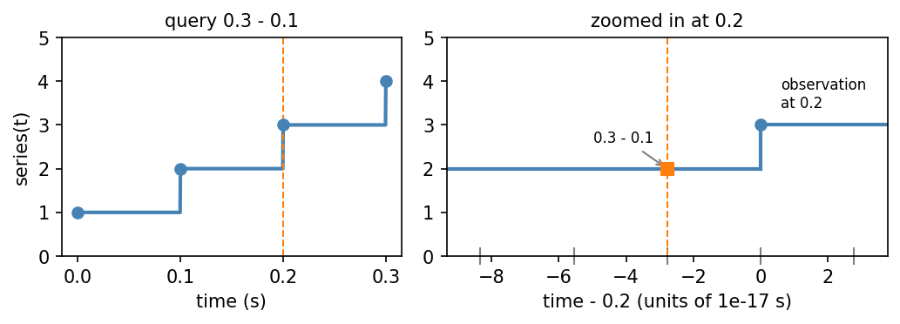
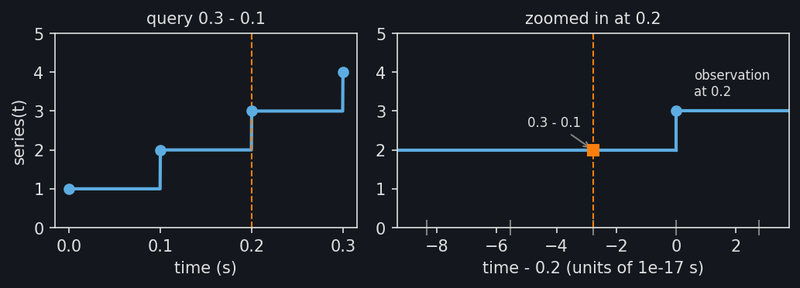
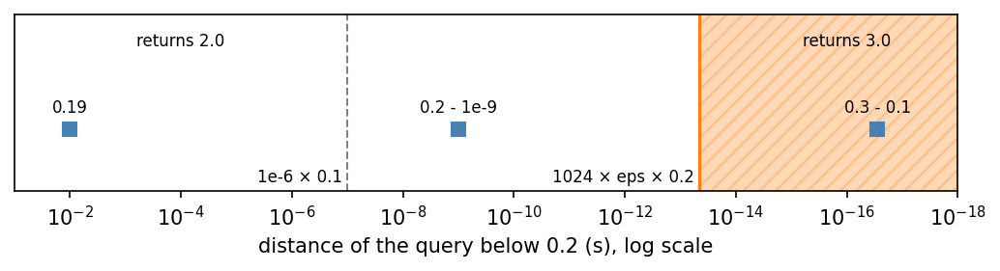
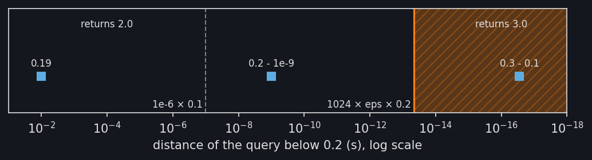

Snapping queries to timestamps
==============================

A :py:class:`~stablebear.timeseries.TimeSeries` evaluated at a time returns
the observation with the largest timestamp at or before that time; see
:doc:`timeseries`. This page explains how
:py:meth:`~stablebear.timeseries.TimeSeries.evaluate` handles queries that
miss a timestamp by a rounding error, and how the ``snap_tolerance`` and
``snap_eps`` arguments control it.

Rounding errors in queries
--------------------------

Query times are often computed rather than typed in. Take a series sampled
every 0.1 s and ask for the value 0.1 s before the last observation, at
``0.3 - 0.1``. The intended query is 0.2, which should return the
observation 3.0 recorded there. The figure shows what happens instead.

.. dropdown:: Show plotting code
   :color: secondary

   .. literalinclude:: _static/gen_timeseries_snap_fig.py
      :pyobject: plot_timeseries_rounding
      :language: python

At the scale of the whole series, the query (dashed) sits on 0.2. Zoomed
in, the gray ticks on the time axis mark the float64 values near 0.2, about
``2.8e-17`` s apart. Neither 0.1 nor 0.3 is exactly representable, and
``0.3 - 0.1`` rounds to ``0.19999999999999998``, the float64 value just
below 0.2. Without snapping, that query gets the observation from 0.1:
a rounding error of ``2.8e-17`` s changes the result by a whole
observation.

Two limits
----------

To avoid this, a query that falls slightly before a timestamp is treated as
if it were at that timestamp. "Slightly" has two limits, and the query must
be within both:

- ``snap_tolerance`` times the time since the previous timestamp. The default
  ``snap_tolerance`` is ``1e-6``; here the spacing is 0.1 s, so this limit is
  ``1e-7`` s.
- ``snap_eps`` times machine epsilon times the size of the
  timestamps. Machine epsilon, about ``2.2e-16``, is the relative precision
  of float64. The default ``snap_eps`` is 1024; here the larger
  timestamp is 0.2, so this limit is ``1024 * 2.2e-16 * 0.2``, about
  ``4.5e-14`` s.

Rounding errors are about machine epsilon times the size of the numbers
involved, so ``0.3 - 0.1`` is within both limits, while an ordinary query such as ``0.19`` is far outside them::

   series = TimeSeries([1.0, 2.0, 3.0, 4.0], times=[0.0, 0.1, 0.2, 0.3])
   series(0.3 - 0.1)  # 3.0
   series(0.19)       # 2.0

   exact = TimeSeries([1.0, 2.0, 3.0, 4.0], times=[0.0, 0.1, 0.2, 0.3],
                      snap_tolerance=0.0)
   exact(0.3 - 0.1)   # 2.0

The figure places three queries by how far they fall below 0.2, on a log
scale. Only queries in the shaded range, within both limits, return the
observation at 0.2. The rounding error of ``0.3 - 0.1`` is well inside it.
``0.2 - 1e-9`` is within the spacing limit (dashed) but not the epsilon
limit (solid), so it returns the observation at 0.1, as does ``0.19``.

.. dropdown:: Show plotting code
   :color: secondary

   .. literalinclude:: _static/gen_timeseries_snap_fig.py
      :pyobject: plot_timeseries_snap_distances
      :language: python

Each limit guards against a different mistake. The spacing limit keeps the
rule from skipping an observation: since ``snap_tolerance`` must be below 1,
it never reaches the previous timestamp, whatever the time unit. The epsilon
limit keeps widely spaced observations from capturing queries that are
clearly earlier. With daily observations in seconds, the spacing limit
alone would be 86 ms, while the epsilon limit at 86400 s is about
``2e-8`` s. Both limits are relative, so changing the time unit changes
neither which queries snap nor which observation they return.

The rule
--------

Precisely, let :math:`r` be ``snap_tolerance``, :math:`k` be
``snap_eps``, and :math:`\varepsilon` be machine epsilon, and let the
timestamps be :math:`t_0 < t_1 < \cdots < t_{n-1}`. At a time
:math:`t \geq t_0`, the series takes observation :math:`i`, where :math:`i`
is the largest index such that :math:`i = 0` or

.. math::

   t \geq t_i - \min\bigl(r (t_i - t_{i-1}),\
   k \varepsilon \max(|t_{i-1}|, |t_i|)\bigr).

With :math:`r = 0` or :math:`k = 0`, this is the last observation at or
before :math:`t`. The domain check is exact: a query just below the first
timestamp raises an error rather than snapping.

Choosing the limits
-------------------

The default fits most data, but not large timestamps with fine spacing.
For example, Unix timestamps in seconds are near ``1.7e9``, where float64
values are about ``2.4e-7`` s apart. With observations every microsecond, a
single rounding error is then about a quarter of the spacing, beyond the
default ``snap_tolerance``. Pass a larger value, such as
``snap_tolerance=0.3``, or store the timestamps relative to a nearby start
time. The epsilon limit, about ``4e-4`` s at this size, already covers the
error. Conversely, when queries are computed in long chains of arithmetic
whose errors exceed a few epsilons, raise ``snap_eps``.
