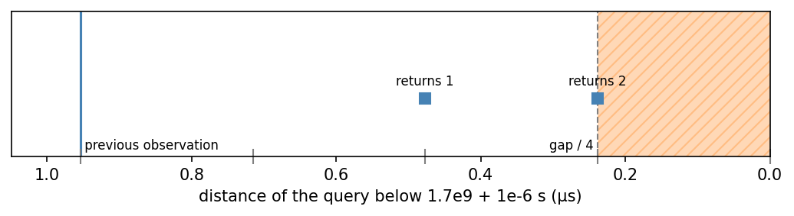
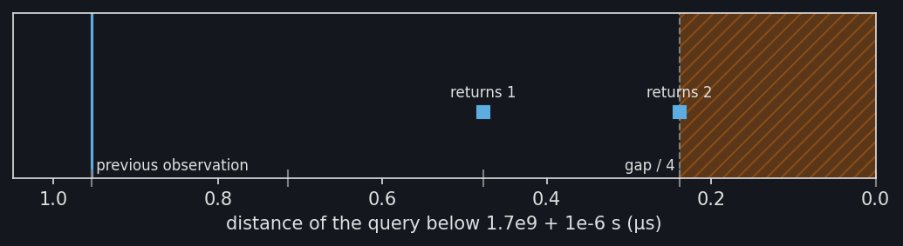

Snapping queries to timestamps
==============================

A :py:class:`~stablebear.timeseries.TimeSeries` evaluated at a time returns
the observation with the largest timestamp at or before that time; see
:doc:`timeseries`. This page explains how
:py:meth:`~stablebear.timeseries.TimeSeries.evaluate` handles queries that
miss a timestamp by a rounding error, and how the ``snap_tolerance``
argument controls it.

Rounding errors in queries
--------------------------

Query times are often computed rather than typed in. Take a time series sampled
every 0.1 s and ask for the value 0.1 s before the last observation, at
``0.3 - 0.1``. The intended query is 0.2, which should return the
observation 3.0 recorded there. The figure shows what happens instead.

.. image:: _static/timeseries_rounding_light.png
   :width: 100%
   :class: only-light
   :alt: The query 0.3 - 0.1 lands one float64 value below 0.2

.. image:: _static/timeseries_rounding_dark.png
   :width: 100%
   :class: only-dark
   :alt: The query 0.3 - 0.1 lands one float64 value below 0.2

.. dropdown:: Show plotting code
   :color: secondary

   .. literalinclude:: _static/gen_timeseries_snap_fig.py
      :pyobject: plot_timeseries_rounding
      :language: python

At the scale of the whole time series, the query (dashed) sits on 0.2. Zoomed
in, the gray ticks on the time axis mark the float64 values near 0.2, about
``2.8e-17`` s apart. Neither 0.1 nor 0.3 is exactly representable, and
``0.3 - 0.1`` rounds to ``0.19999999999999998``, the float64 value just
below 0.2. Without snapping, that query gets the observation from 0.1:
a rounding error of ``2.8e-17`` s changes the result by a whole
observation.

Tolerant comparison
-------------------

To avoid this, a query that falls slightly before a timestamp is treated as
if it were at that timestamp. "Slightly" means within ``snap_tolerance``
times the size of the timestamps, as in the tolerant comparison of APL
:footcite:`Bernecky1977,Hui2014`. Rounding errors are about machine
epsilon, ``2.2e-16``, times the size of the numbers involved, so a tolerance
relative to the size of the timestamps scales with them, whatever the time
unit. The default ``snap_tolerance`` is ``1e-14``, about 45 machine
epsilons, the default of APL. Here the larger timestamp is 0.2, so a query
up to ``2e-15`` s below it snaps. This takes in the rounding error of
``0.3 - 0.1`` while an ordinary query such as ``0.19`` is far outside::

   series = TimeSeries([1.0, 2.0, 3.0, 4.0], times=[0.0, 0.1, 0.2, 0.3])
   series(0.3 - 0.1)  # 3.0
   series(0.19)       # 2.0

   exact = TimeSeries([1.0, 2.0, 3.0, 4.0], times=[0.0, 0.1, 0.2, 0.3],
                      snap_tolerance=0.0)
   exact(0.3 - 0.1)   # 2.0

The figure places three queries by how far they fall below 0.2, on a log
scale. Only queries in the shaded range return the observation at 0.2. The
rounding error of ``0.3 - 0.1`` is well inside it. A query ``1e-14`` s
below 0.2, five times the tolerance there, already returns the observation
at 0.1, as ``0.19`` does. The dashed line is a quarter of the
gap to the previous timestamp, explained below.

.. image:: _static/timeseries_snap_distances_light.png
   :width: 100%
   :class: only-light
   :alt: Only queries within 1e-14 times 0.2 below 0.2 return the observation at 0.2

.. image:: _static/timeseries_snap_distances_dark.png
   :width: 100%
   :class: only-dark
   :alt: Only queries within 1e-14 times 0.2 below 0.2 return the observation at 0.2

.. dropdown:: Show plotting code
   :color: secondary

   .. literalinclude:: _static/gen_timeseries_snap_fig.py
      :pyobject: plot_timeseries_snap_distances
      :language: python

A quarter of the gap
--------------------

A tolerance relative to the size of the timestamps is generous when the
timestamps are large and close together. Unix timestamps in seconds are near
``1.7e9``, where the tolerance allows ``1.7e-5`` s, more than a microsecond
gap between observations. Snapping therefore also stops at a quarter of the
gap to the previous timestamp, so that a query nearer the previous
observation never snaps forward and no observation is skipped. The figure
shows the float64 values between two observations a microsecond apart at
this size, about ``2.4e-7`` s apart. A query one of them below the later
observation snaps to it, and one two below does not.

.. dropdown:: Show plotting code
   :color: secondary

   .. literalinclude:: _static/gen_timeseries_snap_fig.py
      :pyobject: plot_timeseries_snap_quarter
      :language: python

The rule
--------

Precisely, let :math:`r` be ``snap_tolerance``, and let the timestamps be
:math:`t_0 < t_1 < \cdots < t_{n-1}`. At a time :math:`t \geq t_0`, the time
series takes observation :math:`i`, where :math:`i` is the largest index
such that :math:`i = 0` or

.. math::

   t \geq t_i - \min\bigl(r \max(|t_{i-1}|, |t_i|),\ (t_i - t_{i-1}) / 4\bigr).

With :math:`r = 0`, this is the last observation at or before :math:`t`. The
domain check is exact: a query just below the first timestamp raises an
error rather than snapping.

Choosing the tolerance
----------------------

The default fits most data. When queries are computed in long chains of
arithmetic whose errors exceed a few dozen machine epsilons, raise
``snap_tolerance``; pass 0 to compare exactly. Timestamps only a few
float64 values apart have already lost timing precision when they were
rounded to float64; store them relative to a nearby start time instead.

References
----------

.. footbibliography::
