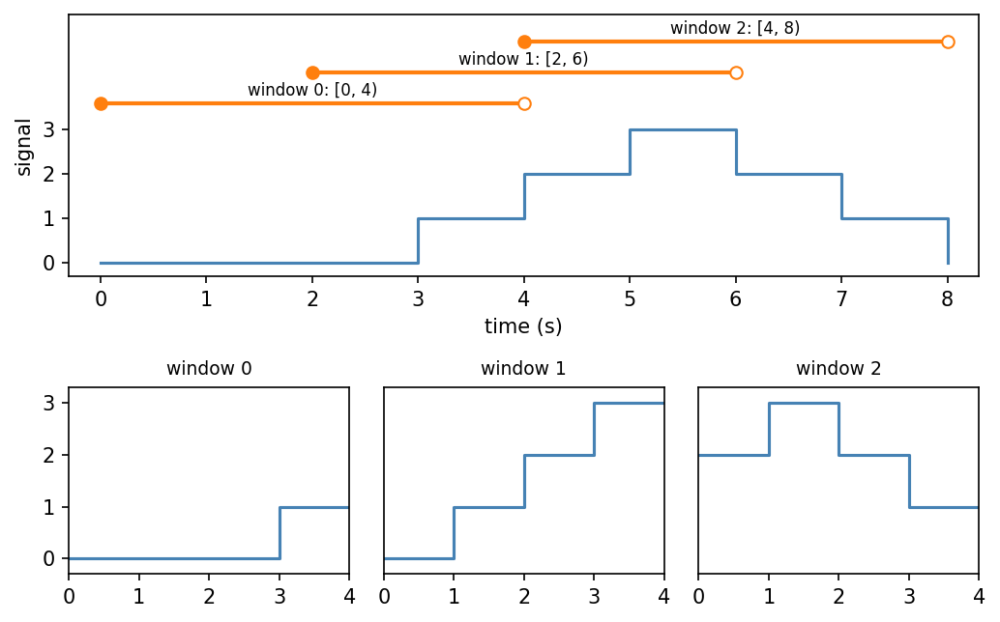
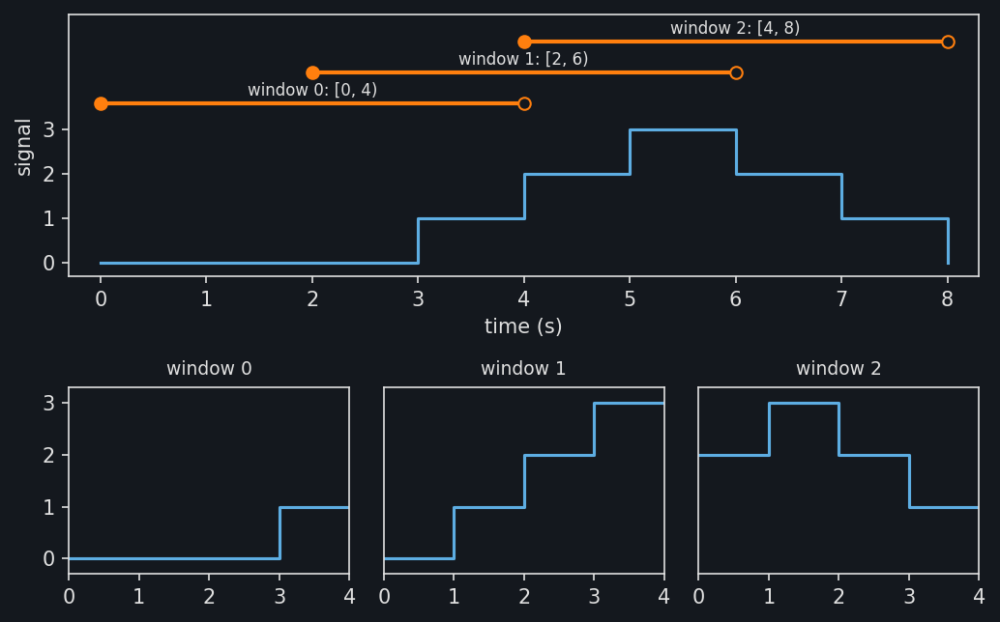

Windows
=======

A window restricts a time series to an interval of time, so that pieces of one
signal can be compared with each other. :py:class:`~stablebear.timeseries.Window`
cuts a time series into windows of a fixed size at a fixed step. Each window is
a time series whose times start at 0.

Here three windows of 4 s, one every 2 s, cut a signal observed once a
second. Its observations stay at 0, rise by 1 each second to 3, and fall
back to 0::

   import numpy as np
   from stablebear.timeseries import TimeSeries, Window

   signal = TimeSeries([0.0, 0.0, 0.0, 1.0, 2.0, 3.0, 2.0, 1.0, 0.0],
                       times=np.arange(9.0))

   windows, bounds = Window(size=4.0, step=2.0, anchor="start")(
       signal, return_bounds=True)
   bounds  # [[0.0, 4.0], [2.0, 6.0], [4.0, 8.0]]

The figure shows ``signal`` with the domains of the three windows marked
above it, and below it each window as a time series of its own, evaluated
on its domain :math:`[0, 4)`.

.. dropdown:: Show plotting code
   :color: secondary

   .. literalinclude:: _static/gen_timeseries_snap_fig.py
      :pyobject: plot_timeseries_windows
      :language: python

The windows are returned as a
:py:class:`~stablebear.timeseries.series.TimeSeriesTensor` of shape
``(n,)``, where ``n`` is the number of windows (here ``n = 3``).
Evaluating the tensor at some times evaluates every window at those times,
in the time of the window. The result is a tensor with one axis for the
windows followed by the axes of the times, so here ``windows(t)[i, j]`` is
window ``i`` at ``t[j]``::

   windows(1.0)[1]      # 1.0, the value of signal at 3 s
   windows([0.0, 1.0])  # [[0.0, 0.0], [0.0, 1.0], [2.0, 3.0]], shape (3, 2)

Windows from the start
----------------------

By default the last window ends where the time series ends, and time at the
start that no full window covers is left out. With ``anchor="start"``, the
first window starts where the time series starts instead, and the time left out
is at the end::

   series = TimeSeries([0.0, 10.0, 20.0, 30.0, 40.0, 50.0],
                       times=[0.0, 1.0, 2.0, 3.0, 4.0, 5.0])

   _, bounds = Window(size=2.0)(series, return_bounds=True)
   bounds  # [[1.0, 3.0], [3.0, 5.0]]

   _, bounds = Window(size=2.0, anchor="start")(series, return_bounds=True)
   bounds  # [[0.0, 2.0], [2.0, 4.0]]

Either way the windows come in chronological order. By default each window
is closed at its anchor end, :math:`(a, a + \text{size}]` from the end and
:math:`[a, a + \text{size})` from the start, so the observation at 5 s is in
the last window, and the one at 0 s is in the first window from the start.
With ``partial=True``, the time left out becomes a shorter window, at the
start of the time series or, with ``anchor="start"``, at its end.

Windows of several channels
---------------------------

On a time series with several :doc:`channels <timeseries_channels>`, the
windows cover only the time where every channel can be evaluated, and every
window has the same channels. Each channel is windowed separately, with its
own timestamps, so a window can hold a different number of observations in
each channel. The channels ``a`` and ``b`` from :doc:`timeseries_channels`
can both be evaluated from 0.05 s to 0.13 s, and windows of 40 ms cut this
time in two::

   a = TimeSeries([1.0, 2.0, 3.0, 4.0], times=[0.0, 0.1, 0.2, 0.3])
   b = TimeSeries([10.0, 20.0, 30.0],
                  times=Times([50.0, 90.0, 130.0], unit="ms"))
   series = TimeSeries.from_channels([a, b], unit="s")

   windows, bounds = Window(size=0.04, anchor="start")(
       series, return_bounds=True)
   bounds  # [[0.05, 0.09], [0.09, 0.13]]

Evaluating the windows gives one tensor per channel, as evaluating a time
series with several channels does, each with one axis for the windows
followed by the axes of the times. In the second window, ``a`` changes from
1.0 to 2.0 at 0.01 s, with its observation at 0.1 s, while ``b`` keeps its
observation 20.0 from 0.09 s::

   values = windows([0.0, 0.02])
   values[0]  # [[1.0, 1.0], [1.0, 2.0]], from a
   values[1]  # [[10.0, 10.0], [20.0, 20.0]], from b
