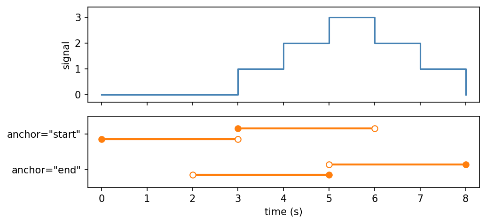
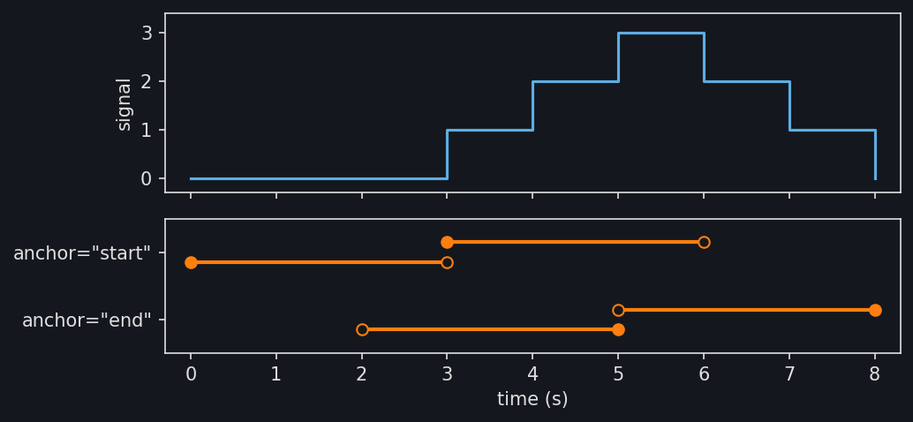
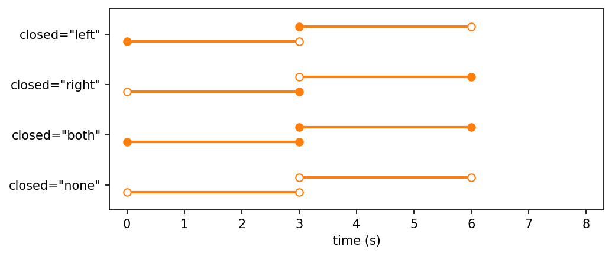
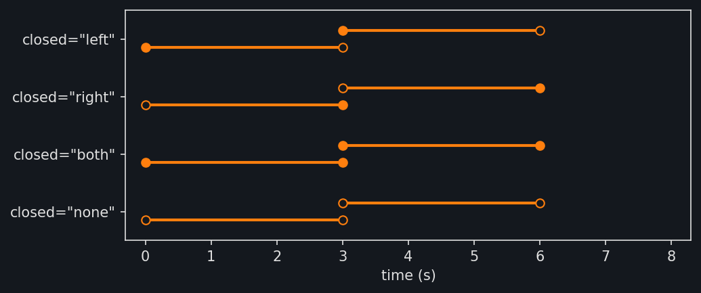
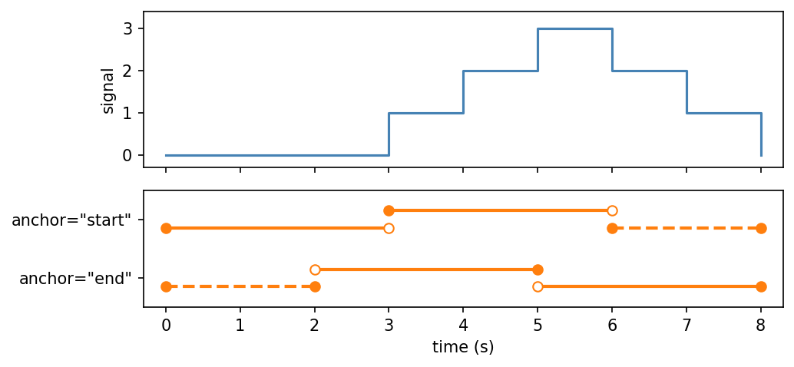
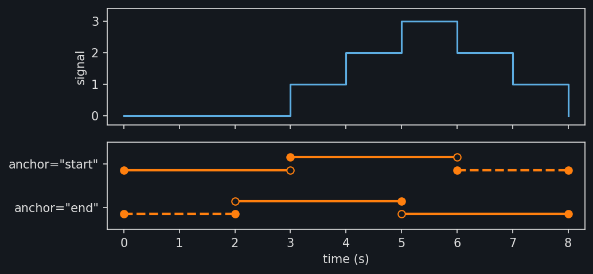
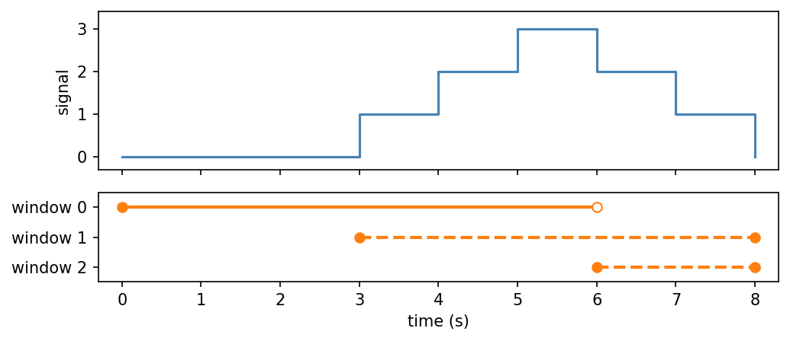
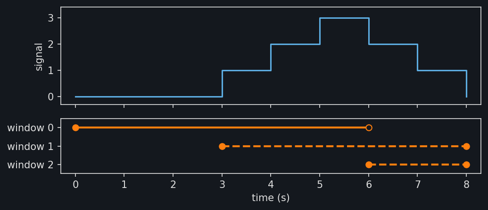

Windows
=======

A window restricts a time series to an interval of time, so that pieces of one
signal can be compared with each other. :py:class:`~stablebear.timeseries.Window`
cuts a time series into windows of a fixed size at a fixed step. Each window is
a time series whose times start at 0.

Here three windows of 4 s, one every 2 s, cut a signal observed once a
second. Its observations stay at 0, rise by 1 each second to 3, and fall
back to 0::

   import numpy as np
   from stablebear.timeseries import TimeSeries, Window

   signal = TimeSeries([0.0, 0.0, 0.0, 1.0, 2.0, 3.0, 2.0, 1.0, 0.0],
                       times=np.arange(9.0))

   windows, bounds = Window(size=4.0, step=2.0, anchor="start")(
       signal, return_bounds=True)
   bounds  # [[0.0, 4.0], [2.0, 6.0], [4.0, 8.0]]

The figure shows ``signal`` with the domains of the three windows marked
above it, and below it each window as a time series of its own, evaluated
on its domain :math:`[0, 4)`.

.. image:: _static/timeseries_windows_light.png
   :width: 90%
   :class: only-light
   :alt: A flat, rising, then falling signal cut into three overlapping windows

.. image:: _static/timeseries_windows_dark.png
   :width: 90%
   :class: only-dark
   :alt: A flat, rising, then falling signal cut into three overlapping windows

.. dropdown:: Show plotting code
   :color: secondary

   .. literalinclude:: _static/gen_timeseries_snap_fig.py
      :pyobject: plot_timeseries_windows
      :language: python

The windows are returned as a
:py:class:`~stablebear.timeseries.series.TimeSeriesTensor` of shape
``(n,)``, where ``n`` is the number of windows (here ``n = 3``).
Evaluating the tensor at some times evaluates every window at those times,
in the time of the window. The result is a tensor with one axis for the
windows followed by the axes of the times, so here ``windows(t)[i, j]`` is
window ``i`` at ``t[j]``::

   windows(1.0)[1]      # 1.0, the value of signal at 3 s
   windows([0.0, 1.0])  # [[0.0, 0.0], [0.0, 1.0], [2.0, 3.0]], shape (3, 2)

A window also keeps where it was cut from.
:py:attr:`~stablebear.timeseries.TimeSeries.origin` is the time in
``signal`` that the window's time 0 stands for, so an observation at time
``t`` in the window was at ``origin + t`` in ``signal``::

   windows[1].origin  # 2.0

Here the origins are the starts in ``bounds``. They differ only when a start
falls just short of an observation and snaps to it (see
:doc:`timeseries_snapping`): the bound keeps the computed start, and the
origin is the observation's time. Evaluation does not use the origin, and
:py:meth:`~stablebear.timeseries.TimeSeries.array_equal` ignores it, so
windows with the same contents cut from different places are equal.

Anchoring
---------

With ``anchor="start"``, as above, the windows start where the time series
starts. With ``anchor="end"``, the default, they end where it ends. The two
differ when the windows do not fit exactly, as windows of 3 s on the 8 s of
``signal`` do not::

   _, bounds = Window(size=3.0, anchor="start")(signal, return_bounds=True)
   bounds  # [[0.0, 3.0], [3.0, 6.0]]

   _, bounds = Window(size=3.0)(signal, return_bounds=True)
   bounds  # [[2.0, 5.0], [5.0, 8.0]]

The figure shows both sets of windows below ``signal``. Filled circles
mark the ends a window includes, and hollow circles the ends it leaves out.

.. dropdown:: Show plotting code
   :color: secondary

   .. literalinclude:: _static/gen_timeseries_snap_fig.py
      :pyobject: _plot_window_rows
      :language: python

   .. literalinclude:: _static/gen_timeseries_snap_fig.py
      :pyobject: plot_timeseries_window_anchors
      :language: python

Either way the windows are returned in chronological order. By default
each window is closed at its anchor end and open at the other. With
:math:`s_k` the start of the :math:`k`-th window, as in ``bounds``, the
windows from the start are

.. math::

   [s_1, s_1 + \text{size}), [s_2, s_2 + \text{size}), \dots, [s_n, s_n + \text{size}),

and the windows from the end are

.. math::

   (s_1, s_1 + \text{size}], (s_2, s_2 + \text{size}], \dots, (s_n, s_n + \text{size}].

Closed ends
-----------

The ``closed`` argument chooses which ends every window includes. Its
default, the anchor end as above, puts the observation at the anchor in a
window. Of the four choices, ``"left"`` gives
:math:`[s_k, s_k + \text{size})`, ``"right"`` gives
:math:`(s_k, s_k + \text{size}]`, ``"both"`` gives
:math:`[s_k, s_k + \text{size}]`, and ``"none"`` gives
:math:`(s_k, s_k + \text{size})`. A window can be evaluated at an end only
if it includes that end, and an observation where two windows meet belongs
to each window that includes it::

   windows = Window(size=3.0, anchor="start", closed="both")(signal)
   windows(3.0)  # [1.0, 2.0], the values of signal at 3 s and 6 s

   windows = Window(size=3.0, anchor="start")(signal)  # closed="left"
   windows(3.0)  # ValueError: Time 3 is outside the domain [0, 3)

The figure shows the windows of 3 s from the start for each choice.

.. dropdown:: Show plotting code
   :color: secondary

   .. literalinclude:: _static/gen_timeseries_snap_fig.py
      :pyobject: plot_timeseries_window_closed
      :language: python

Partial windows
---------------

With ``partial=True``, the windows continue to the far end of the time
series, and those that would run past it are cut short there. With
:math:`t_0` and :math:`T` the start and end of the time series, a window
:math:`[s_k, s_k + \text{size})` from the start with
:math:`s_k + \text{size} > T` becomes :math:`[s_k, T]`, and a window
:math:`(s_k, s_k + \text{size}]` from the end with :math:`s_k < t_0`
becomes :math:`[t_0, s_k + \text{size}]`. A window cut short includes the
end of the time series it is cut at, whatever ``closed`` is. The rows of
``bounds`` hold the ends after cutting::

   _, bounds = Window(size=3.0, anchor="start", partial=True)(
       signal, return_bounds=True)
   bounds  # [[0.0, 3.0], [3.0, 6.0], [6.0, 8.0]]

   _, bounds = Window(size=3.0, partial=True)(signal, return_bounds=True)
   bounds  # [[0.0, 2.0], [2.0, 5.0], [5.0, 8.0]]

In the figure, the dashed windows are the ones cut short.

.. dropdown:: Show plotting code
   :color: secondary

   .. literalinclude:: _static/gen_timeseries_snap_fig.py
      :pyobject: _plot_window_rows
      :language: python

   .. literalinclude:: _static/gen_timeseries_snap_fig.py
      :pyobject: plot_timeseries_window_partial
      :language: python

When the step is shorter than the size, several windows can be cut short.
With windows of 6 s every 3 s from the start, the last two are cut
short::

   _, bounds = Window(size=6.0, step=3.0, anchor="start", partial=True)(
       signal, return_bounds=True)
   bounds  # [[0.0, 6.0], [3.0, 8.0], [6.0, 8.0]]

The figure shows each window on its own row.

.. dropdown:: Show plotting code
   :color: secondary

   .. literalinclude:: _static/gen_timeseries_snap_fig.py
      :pyobject: _plot_window_rows
      :language: python

   .. literalinclude:: _static/gen_timeseries_snap_fig.py
      :pyobject: plot_timeseries_window_partial_overlap
      :language: python

A window that starts exactly at :math:`T` becomes :math:`[T, T]` and holds
only the last observation.

Windows of several channels
---------------------------

On a time series with several :doc:`channels <timeseries_channels>`, the
windows cover only the time where every channel can be evaluated, and every
window has the same channels. Each channel is windowed separately, with its
own timestamps, so a window can hold a different number of observations in
each channel. The channels ``a`` and ``b`` from :doc:`timeseries_channels`
can both be evaluated from 0.05 s to 0.13 s, and windows of 40 ms cut this
time in two::

   a = TimeSeries([1.0, 2.0, 3.0, 4.0], times=[0.0, 0.1, 0.2, 0.3])
   b = TimeSeries([10.0, 20.0, 30.0],
                  times=Times([50.0, 90.0, 130.0], unit="ms"))
   series = TimeSeries.from_channels([a, b], unit="s")

   windows, bounds = Window(size=0.04, anchor="start")(
       series, return_bounds=True)
   bounds  # [[0.05, 0.09], [0.09, 0.13]]

Evaluating the windows gives one tensor per channel, as evaluating a time
series with several channels does, each with one axis for the windows
followed by the axes of the times. In the second window, ``a`` changes from
1.0 to 2.0 at 0.01 s, with its observation at 0.1 s, while ``b`` keeps its
observation 20.0 from 0.09 s::

   values = windows([0.0, 0.02])
   values[0]  # [[1.0, 1.0], [1.0, 2.0]], from a
   values[1]  # [[10.0, 10.0], [20.0, 20.0]], from b
